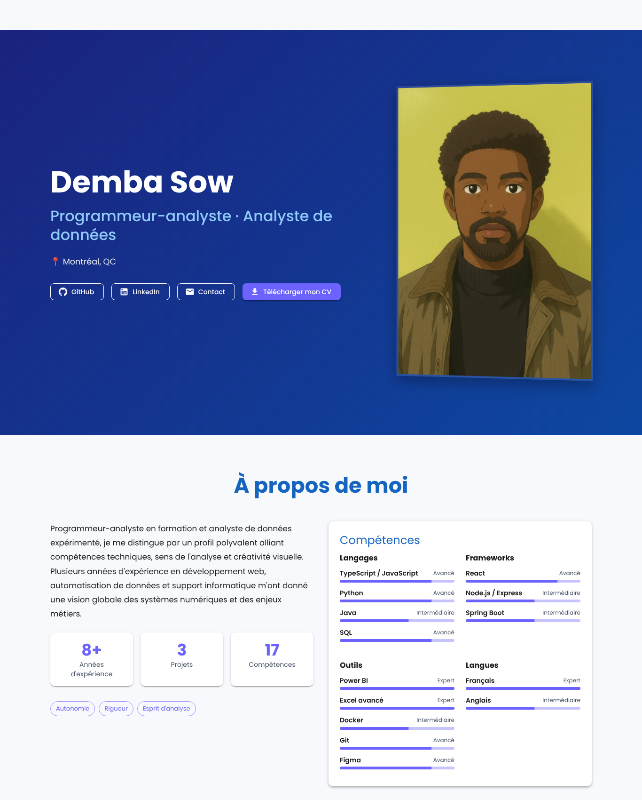
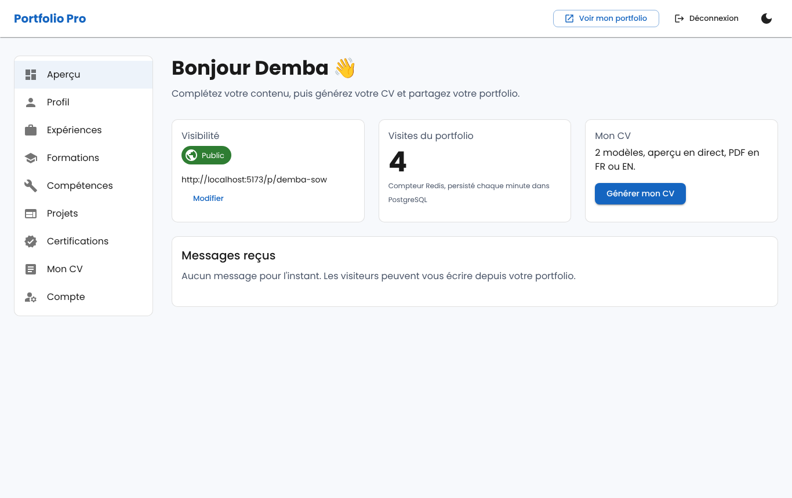
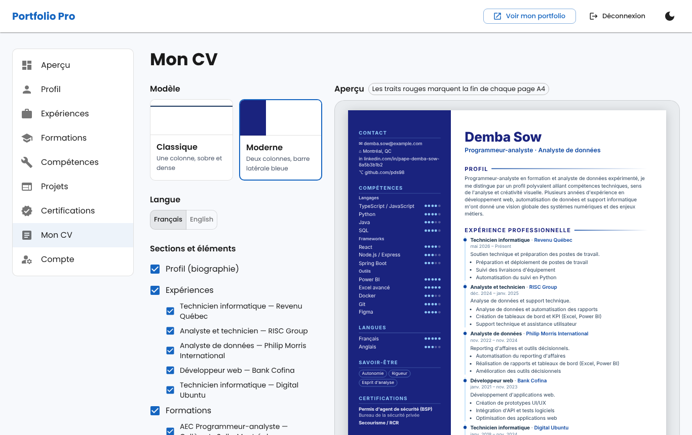
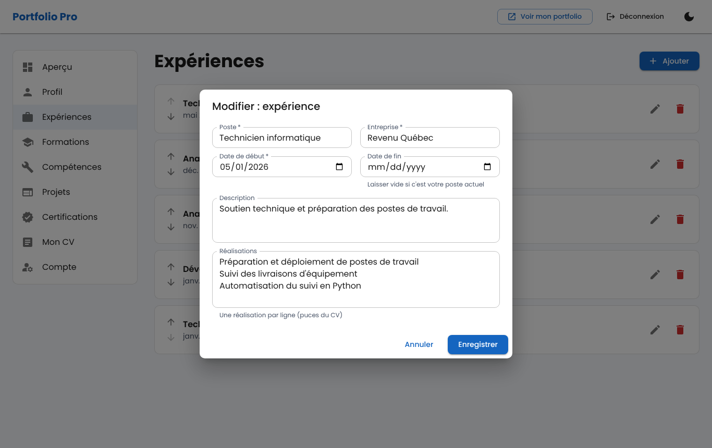
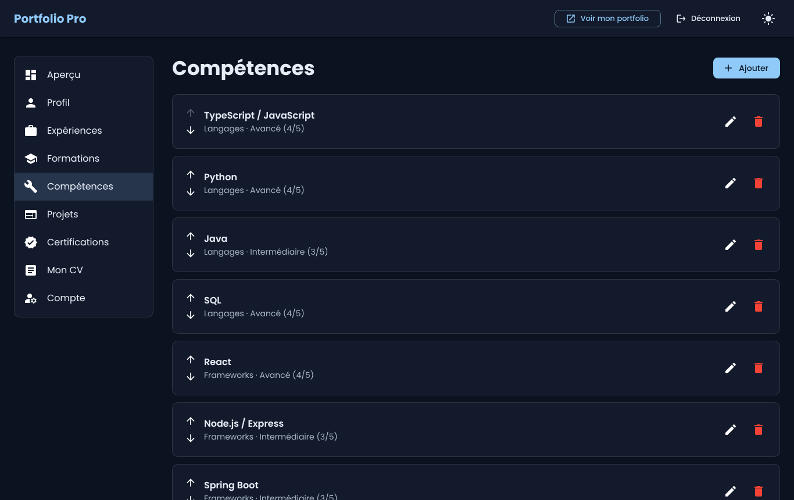
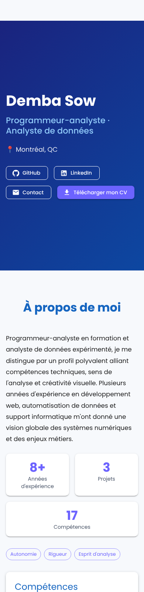

# Portfolio professionnel avec génération de CV

Application web full-stack qui permet à un étudiant de présenter son parcours sur un **portfolio public** et de générer un **CV PDF** à partir des mêmes données.

> Projet du cours *Tendances technologiques* · Collège LaSalle · Demba Sow
> Stack : **React (Vite) · Express · TypeScript · PostgreSQL · Redis · Docker**



## Fonctionnalités

**Espace public** (visiteur, employeur, sans compte) : `/p/demba-sow`

- Portfolio responsive : présentation, compétences, expériences en frise, projets filtrables, formations, certifications, contact.
- Données servies depuis le **cache Redis**, invalidé à chaque modification.
- Téléchargement du CV si l'étudiant l'autorise. Formulaire de contact et carte de visite en QR code.

**Espace privé** (étudiant connecté) : `/dashboard`

- Inscription / connexion (bcrypt + **sessions Redis**), changement de mot de passe, suppression du compte.
- CRUD du profil, des expériences, formations, compétences, projets et certifications, avec **ordre d'affichage modifiable**.
- Choix public / privé, adresse personnalisée (slug), autorisation de téléchargement du CV.
- **Générateur de CV** :
  - 2 modèles (classique et moderne) ;
  - choix des sections **et** des éléments ;
  - aperçu en direct ;
  - PDF `CV_Prenom_Nom.pdf` d'une ou deux pages, mis en cache dans Redis ;
  - versions français et anglais, export JSON Resume.
- Statistiques de visites (compteur Redis, persisté dans PostgreSQL) et messages reçus.
- Thème clair / sombre.

| Tableau de bord | Générateur de CV |
|---|---|
|  |  |

| Édition d'une expérience | Thème sombre | Mobile |
|---|---|---|
|  |  |  |

Exemples de CV générés : [classique](docs/exemples/CV_Demba_Sow_classique.pdf) · [moderne](docs/exemples/CV_Demba_Sow_moderne.pdf) · [moderne (EN)](docs/exemples/CV_Demba_Sow_modern_EN.pdf) · [JSON Resume](docs/exemples/CV_Demba_Sow.json)

## Prérequis

- [Docker Desktop](https://www.docker.com/products/docker-desktop/) (Docker Engine 24+ avec Compose v2)
- Ports libres : 5173, 3000, 5432, 6379
- *(Optionnel, développement hors Docker)* Node.js 20+

## Installation et lancement

```bash
git clone <url-du-depot> portfolio-cv
cd portfolio-cv
cp .env.example .env          # puis changez POSTGRES_PASSWORD
docker compose up --build
```

| Service | Adresse |
|---|---|
| Frontend | http://localhost:5173 |
| API (état des services) | http://localhost:3000/api/health |
| PostgreSQL | localhost:5432 |
| Redis | localhost:6379 |

**Compte de démonstration** (créé automatiquement par `backend/db/seed.sql`) :

| Courriel | Mot de passe | Portfolio |
|---|---|---|
| `demba.sow@example.com` | `Portfolio2026!` | http://localhost:5173/p/demba-sow |

> Les scripts `init.sql` et `seed.sql` ne s'exécutent que sur une base **vide**. Pour repartir de zéro : `docker compose down -v` puis `docker compose up --build`.

## Variables d'environnement

Définies dans `.env` (jamais versionné) ; modèle : [`.env.example`](.env.example).

| Variable | Défaut | Rôle |
|---|---|---|
| `POSTGRES_DB` / `POSTGRES_USER` | `portfolio` | Base et utilisateur PostgreSQL |
| `POSTGRES_PASSWORD` | *(obligatoire)* | Mot de passe PostgreSQL |
| `PORT` | `3000` | Port de l'API |
| `CORS_ORIGIN` | `http://localhost:5173` | Origine autorisée à appeler l'API avec le cookie |
| `SESSION_TTL_SECONDS` | `604800` (7 j) | Durée d'une session |
| `PUBLIC_CACHE_TTL_SECONDS` | `300` | Durée du cache du portfolio public |
| `CV_CACHE_TTL_SECONDS` | `86400` | Durée du cache des PDF |
| `AUTH_RATE_LIMIT_MAX` | `10` | Échecs de connexion tolérés / IP / 15 min |
| `BCRYPT_ROUNDS` | `12` | Coût du hachage |
| `VITE_API_URL` | `http://localhost:3000` | Adresse de l'API vue par le navigateur |

`DATABASE_URL`, `REDIS_URL` et `PUPPETEER_EXECUTABLE_PATH` sont fournis automatiquement par `docker-compose.yml` et le `Dockerfile`.

## Commandes utiles

```bash
# Tests
docker compose exec backend npm test                  # unitaires
docker compose exec backend npm run test:integration  # + intégration PostgreSQL/Redis + PDF
docker compose exec frontend npm test

# Qualité
docker compose exec backend npm run lint
docker compose exec backend npm run typecheck
docker compose exec frontend npm run lint
docker compose exec frontend npm run typecheck

# Inspecter Redis pendant la démo
docker compose exec redis redis-cli KEYS '*'
docker compose exec redis redis-cli MONITOR
```

Démontrer le cache Redis :

```bash
curl -sI http://localhost:3000/api/public/demba-sow | grep X-Cache   # MISS
curl -sI http://localhost:3000/api/public/demba-sow | grep X-Cache   # HIT
# modifier une compétence dans le tableau de bord, puis :
curl -sI http://localhost:3000/api/public/demba-sow | grep X-Cache   # MISS
```

## Documentation

- [Documentation technique](docs/ARCHITECTURE.md) : architecture, **diagramme entité-relation**, usage de Redis, justification des choix (Puppeteer, sessions, etc.), sécurité, accessibilité, bibliothèques et **déclaration d'utilisation de l'IA**
- [Documentation de l'API](docs/API.md) : tous les points d'accès, paramètres et codes de réponse
- [Rapport de tests](docs/TESTS.md) : 66 tests et correspondance avec les exigences

## Structure

```
.
├── docker-compose.yml        4 services : frontend, backend, postgres, redis
├── .env.example
├── backend/                  API Express + TypeScript
│   ├── Dockerfile            multi-étapes (dev / prod) avec Chromium
│   ├── db/init.sql           schéma
│   ├── db/seed.sql           données de démonstration
│   ├── src/                  routes, middlewares, services, gabarits de CV
│   └── tests/                Vitest (unitaires + intégration)
├── frontend/                 React + Vite + TypeScript
│   ├── Dockerfile            multi-étapes (dev Vite / prod nginx)
│   └── src/                  pages, composants, contexte, client API, tests
├── docs/                     documentation, captures, exemples de CV
└── .github/workflows/ci.yml  intégration continue (lint, typage, tests, build)
```

## Crédits

L'interface du portfolio public reprend le design de mon portfolio personnel ([github.com/pds98/portfolio](https://github.com/pds98/portfolio)), adapté pour être alimenté par l'API. Utilisation d'outils d'IA déclarée dans la [documentation technique](docs/ARCHITECTURE.md#8-déclaration-dutilisation-de-lia).
