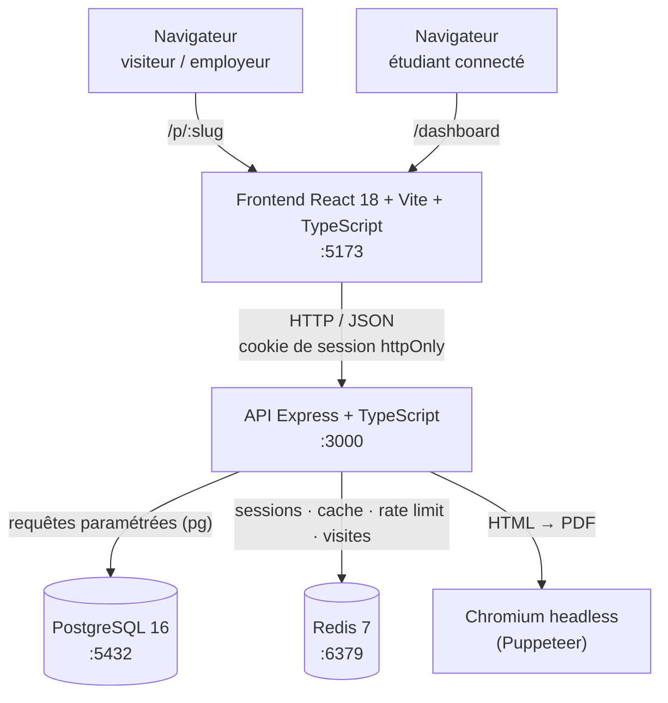
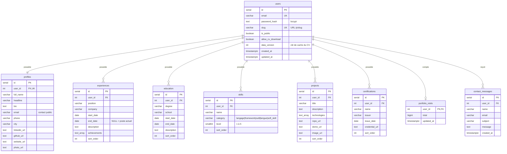

# Documentation technique

## 1. Architecture



| Couche | Technologie | Rôle |
|---|---|---|
| Frontend | React 18, Vite 5, TypeScript strict, React Router 6, MUI 5, Framer Motion, Three.js (intro) | Portfolio public + tableau de bord privé |
| Backend | Node 20, Express 4, TypeScript strict, Zod, Helmet, CORS, bcryptjs, puppeteer-core | API REST sécurisée, génération du CV |
| Base de données | PostgreSQL 16 | Données persistantes |
| Cache / sessions | Redis 7 | Sessions, cache du portfolio et des PDF, limitation du débit, compteur de visites |
| Conteneurs | Docker, Docker Compose | 4 services, démarrage en une commande |

### Organisation du code

```
backend/
  db/init.sql            schéma (exécuté au 1er démarrage de PostgreSQL)
  db/seed.sql            compte de démonstration
  src/
    app.ts               construction de l'application Express (importée par les tests)
    index.ts             démarrage, persistance périodique des visites, arrêt propre
    config.ts            variables d'environnement
    schemas.ts           tous les schémas Zod
    middleware/          requireAuth, rateLimit, errorHandler
    routes/              auth, profile, crud (fabrique générique), public, cv, stats, health
    services/            session, password, cache, portfolio, cv, visits, slug
    cv/                  gabarits HTML (classic, modern), i18n FR/EN, filtre, PDF, JSON Resume
    types/portfolio.ts   contrat partagé avec le frontend
  tests/                 unitaires + integration/
frontend/src/
  api/                   client fetch typé
  context/               AuthContext (session), ThemeModeContext (clair/sombre)
  components/portfolio/  sections du portfolio public (reprises de pds98/portfolio)
  pages/                 accueil, connexion, portfolio public, dashboard/*
  intro/                 animation 3D (projet TypeScript séparé, voir § 5.6)
  types/portfolio.ts     copie du contrat (vérifiée par un test)
```

## 2. Modèle de données (diagramme entité-relation)



Ajouts au modèle minimal du cahier des charges :

- `users.data_version` est incrémentée à chaque écriture et sert de « version des données » dans la clé de cache du PDF (RF-26).
- `users.allow_cv_download` permet au visiteur de télécharger le CV seulement si l'étudiant l'autorise (§3).
- `profiles.email` est le courriel de contact public, distinct du courriel de connexion.
- `experiences.achievements` stocke les réalisations (§4.2) dans un tableau PostgreSQL, une puce par élément du CV.
- `certifications` correspond à la section optionnelle.
- `portfolio_visits` et `contact_messages` servent aux bonus.
- Contraintes : `ON DELETE CASCADE` partout (RF-04), `CHECK` sur les dates, le niveau (1–5), la catégorie et le format du slug, et des index `(user_id, sort_order)`.

## 3. Utilisation de Redis

| Clé | Contenu | TTL | Exigence |
|---|---|---|---|
| `session:{jeton}` | id de l'utilisateur | 7 jours | RF-02 |
| `user_sessions:{userId}` | ensemble des jetons de l'utilisateur | 7 jours | révocation globale (RF-03, RF-04) |
| `portfolio:{slug}` | JSON complet du portfolio public | 5 min | RF-13 (cache-aside) |
| `cv:{userId}:{gabarit}:v{version}:{empreinte}` | PDF binaire | 24 h | RF-26 |
| `ratelimit:{préfixe}:{ip}` | compteur | 15 min / 1 h | bonus : rate limiting |
| `visits:{userId}` | visites non encore persistées | aucun (purgé chaque minute) | bonus : statistiques |

**Invalidation.** Toute écriture (profil, CRUD, réordonnancement, paramètres) appelle `invalidateUserContent()`. Cette fonction fait deux choses :

1. Elle incrémente `data_version`, ce qui rend les PDF en cache obsolètes : leur clé ne correspond plus.
2. Elle supprime `portfolio:{slug}`, ainsi que l'ancien slug si l'adresse a changé.

L'en-tête `X-Cache: HIT|MISS` permet de le démontrer pendant la présentation. Mesures en local : ~2 s pour générer un PDF, ~25 ms quand il est servi depuis Redis.

## 4. API REST

Voir [API.md](API.md).

## 5. Justification des choix technologiques

### 5.1 Génération PDF : Puppeteer (HTML → PDF)

| Critère | **Puppeteer** ✅ | @react-pdf/renderer | pdfkit |
|---|---|---|---|
| Qualité typographique | Excellente (moteur Chromium) | Bonne | Moyenne, positionnement manuel |
| Mise en page | CSS complet (grid, flex, `@page`, `break-inside`) | Sous-ensemble de flexbox | Coordonnées x/y |
| Aperçu (RF-23) | **Le même HTML** est affiché dans une iframe | Rendu séparé nécessaire | Impossible sans générer le PDF |
| Ajouter un gabarit | Une fonction `(données) => HTML` | Un composant | Beaucoup de code |
| Inconvénient | Image Docker plus lourde (Chromium), ~1–2 s par génération | | |

Les inconvénients sont compensés :

- **Image Docker** : on utilise `puppeteer-core` avec le Chromium d'Alpine, sans téléchargement de ~170 Mo.
- **Navigateur** : une seule instance est lancée puis réutilisée, chaque CV ouvre seulement un nouvel onglet.
- **Temps de génération** : le cache Redis (RF-26) évite de régénérer un PDF dont les données n'ont pas changé.
- **RF-24** : si le contenu dépasse 2 pages, l'échelle est réduite progressivement (90 %, 80 %, 72 %) au lieu de tronquer le CV.

### 5.2 Sessions : jeton opaque dans Redis plutôt que JWT

Un jeton aléatoire de 256 bits est placé dans un cookie `httpOnly`, `SameSite=Lax`, `Secure` en production. Redis associe ce jeton à l'id de l'utilisateur.

- **Déconnexion réelle et immédiate** : on supprime la clé. Un JWT, lui, reste valide jusqu'à son expiration.
- **Révocation de toutes les sessions** : possible au changement de mot de passe ou à la suppression du compte.
- **Rien de lisible côté client** : le cookie `httpOnly` est inaccessible au JavaScript, donc protégé du vol par XSS.

### 5.3 bcryptjs

C'est le même algorithme et le même format (`$2b$`) que `bcrypt`, en JavaScript pur : il n'y a aucune compilation native dans l'image Alpine. Le coût est de 12, soit environ 250 ms par hachage.

### 5.4 Zod

Un seul schéma sert à la fois à valider à l'exécution et à typer en TypeScript (`z.infer`). Les champs vides sont normalisés en `null`, et les erreurs sont renvoyées champ par champ (400) pour être affichées sous les champs des formulaires.

### 5.5 CRUD générique

Les 5 ressources (expériences, formations, compétences, projets, certifications) passent par une fabrique `createCrudRouter()`. Cela donne une seule implémentation testée de la sécurité (filtre `user_id`, colonnes en liste blanche, requêtes paramétrées) et du réordonnancement. Le réordonnancement tient en une seule requête `UPDATE … FROM unnest($ids) WITH ORDINALITY`, dans une transaction.

### 5.6 Frontend

- **Réutilisation de mon portfolio existant** (`github.com/pds98/portfolio`, déjà en React/Vite/TS/MUI). Le design et les sections sont conservés, mais tout le contenu codé en dur est remplacé par les données de l'API. Les compteurs inventés sont remplacés par des valeurs calculées.
- **MUI** pour l'accessibilité intégrée (rôles ARIA, focus, navigation au clavier) et le thème clair/sombre.
- **Animation d'intro (Three.js)** chargée à la demande (`React.lazy`), jouée une fois par session, désactivée si l'utilisateur préfère réduire les animations, et avec un bouton « Passer ».
- **Projet TypeScript séparé pour l'intro** (`tsconfig.intro.json` + module virtuel `@intro`) : les types de `@react-three/fiber` ajoutent des milliers d'éléments JSX globaux, ce qui fait échouer le typage des composants MUI (TS2590).

### 5.7 Sécurité (récapitulatif)

| Mesure | Mise en œuvre |
|---|---|
| Mots de passe | bcrypt (coût 12), règles : 8 caractères, une lettre, un chiffre |
| Validation des entrées | Zod sur 100 % des corps et paramètres |
| Injection SQL | Requêtes paramétrées uniquement ; noms de colonnes en liste blanche |
| XSS | React échappe le DOM ; les gabarits du CV passent toutes les données par `escapeHtml()` ; aperçu dans une iframe `sandbox` |
| CSRF | Cookie `SameSite=Lax` + CORS restreint à l'origine du frontend |
| En-têtes | Helmet (CSP, X-Frame-Options, HSTS…) |
| Force brute | Limitation Redis : 10 échecs de connexion / 15 min / IP ; 20 inscriptions / h ; 5 messages de contact / h |
| Contrôle d'accès | Toutes les routes privées passent par `requireAuth` ; chaque requête SQL filtre `user_id` (testé) |
| Secrets | Variables d'environnement ; `.env` ignoré par Git ; `.env.example` fourni |

## 6. Accessibilité et responsive

- HTML sémantique : `header`, `main`, `section` + `aria-labelledby`, `nav`, listes `ol` / `ul`.
- Textes alternatifs sur les images, `aria-label` sur tous les boutons icône et les barres de niveau (« niveau 4 sur 5 »).
- Navigation complète au clavier (composants MUI), contrastes conformes WCAG AA dans les deux thèmes.
- Respect de `prefers-reduced-motion` et de `prefers-color-scheme`.
- Mise en page fluide : frise d'une seule colonne sur mobile, menu latéral remplacé par des onglets défilants, grilles 1, 2 ou 3 colonnes.

## 7. Bibliothèques tierces

**Backend :** express, cors, helmet, cookie-parser, pg, redis, zod, bcryptjs, puppeteer-core. **Outils :** typescript, tsx, vitest, supertest, eslint, typescript-eslint, prettier.

**Frontend :** react, react-dom, react-router-dom, @mui/material, @mui/icons-material, @mui/lab, @emotion/react, @emotion/styled, framer-motion, three, @react-three/fiber, @react-three/drei, gsap, qrcode.react, @fontsource/poppins. **Outils :** vite, vitest, @testing-library/react, @testing-library/user-event, jsdom, eslint, prettier.

## 8. Déclaration d'utilisation de l'IA

Conformément au §12 du cahier des charges : ce projet a été réalisé avec l'aide de **Claude (Anthropic)**, utilisé comme assistant de programmation. L'IA a servi à :

- proposer l'architecture ;
- rédiger une première version du code backend et frontend, des tests et de la documentation ;
- migrer les composants de mon portfolio existant (`pds98/portfolio`) vers une version pilotée par l'API.

J'ai relu, exécuté et testé l'ensemble du code, et je suis en mesure d'expliquer chaque partie lors de la présentation (sessions Redis, invalidation du cache, génération PDF, CRUD générique, etc.).
